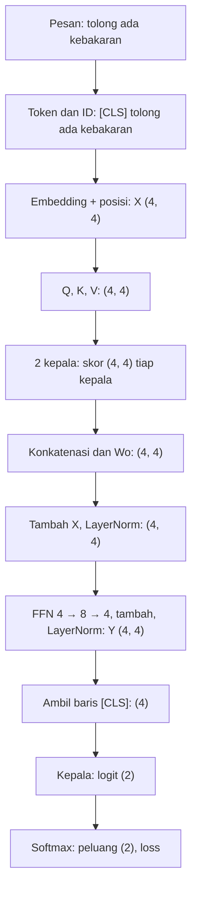

# Part 15 — Integrasi dan Evaluasi Level 5

## Tujuan Pembelajaran

Setelah mempelajari bagian ini, kamu mampu:

- menelusuri aliran data dari **pesan masukan** sampai **prediksi dan loss** dengan menyebut shape tensor di setiap tahap;
- menghubungkan setiap rumus Part 1 sampai 14 dengan **baris kode** yang melaksanakannya;
- membaca implementasi mini-Transformer lengkap (embedding, positional encoding, multi-head attention, residual, LayerNorm, FFN, kepala klasifikasi, loss, *backpropagation*, dan *gradient descent*) yang ditulis dengan pustaka standar;
- memeriksa gradien hasil *backpropagation* dengan turunan numerik;
- menafsirkan hasil pelatihan pada data sangat kecil secara jujur, termasuk batasnya;
- menjawab soal terpadu Deep Learning dan NLP yang menggabungkan beberapa part.

## Prasyarat

Seluruh [Part 1](01-fondasi-matematika-deep-learning.md) sampai [Part 14](14-fondasi-matematis-bert-dan-indobert.md), terutama [Part 6](06-backpropagation-mendalam.md) (graf komputasi), [Part 12](12-attention-dan-self-attention.md) dan [Part 13](13-transformer.md) (attention dan blok Transformer), serta [Part 14](14-fondasi-matematis-bert-dan-indobert.md) (kepala klasifikasi). Untuk pembanding model klasik pada data yang sama, lihat [Level 4 Part 13](../level-4-matematika-ml-klasik/13-integrasi-dan-studi-kasus.md).

## Masalah yang Ingin Diselesaikan

Part 1 sampai 14 membahas komponen satu per satu. Pertanyaan terakhir adalah: **bagaimana semuanya bekerja sebagai satu sistem?** Part ini menyatukannya dalam satu program kecil yang mengklasifikasikan pesan menjadi Emergency atau Non-Emergency (data **simulasi**), lalu melatihnya. Tujuannya bukan model yang bagus, tetapi memperlihatkan bahwa Deep Learning tersusun dari rumus-rumus yang sudah kita pelajari, dalam urutan yang sama dengan yang ada di BERT hanya dengan skala jauh lebih kecil.

## Peta Rumus ke Kode

| Part | Konsep | Rumus | Di kode |
|---|---|---|---|
| 2 | perkalian matriks, transpose | $(m,n)(n,p)\to(m,p)$ | `matmul`, `T` |
| 3 | lapisan | $Z=XW+\mathbf{b}$ | `matmul(...)` lalu `+ c1`, `+ c2`, `+ bc` |
| 4 | aktivasi | $\max(0,z)$, softmax | `relu`, `softmax` |
| 5 | loss | $-\ln p_c$ | `loss_pesan` |
| 6 | graf komputasi dan *backpropagation* | gradien hulu $\times$ turunan lokal | kelas `V`, metode `mundur` |
| 7 | optimasi | $\theta\leftarrow\theta-\eta\,g$ | `latih` |
| 9 | embedding | baris $E[i]$ | `P["E"][i]` |
| 11 | softmax stabil | $\ln p_k=z_k-\operatorname{LSE}$ (di sini: kurangi nilai maksimum) | `softmax` |
| 12 | attention | $\operatorname{softmax}(QK^\top/\sqrt{d_k})V$ | blok `for h in range(H)` |
| 13 | positional encoding, residual, LayerNorm, FFN | lihat Part 13 | `pe`, `layernorm`, `a + b`, `W1`/`W2` |
| 14 | kepala klasifikasi pada `[CLS]` | $\mathbf{z}=\mathbf{h}_{\text{CLS}}W_c+\mathbf{b}_c$ | `matmul([Y[0]], P["Wc"])` |

Part 8 (regularisasi) dan Adam (Part 7) **tidak dipakai** di program ini agar tetap pendek; dengan data sangat kecil, tidak ada validasi yang berarti untuk mengatur keduanya.

## Alur Data dan Shape

Satu pesan, misalnya "tolong ada kebakaran", menjadi barisan token `[CLS] tolong ada kebakaran`, jadi $T=4$. Konfigurasi mini: $d_{\text{model}}=4$, $h=2$ kepala ($d_k=2$), $d_{\text{ff}}=8$, $K=2$ kelas, kosakata $V=11$ token.



| Tahap | Ekspresi | Shape |
|---|---|---|
| ID token | `ids(...)` | $(4)$ |
| embedding + posisi | $E[\text{id}]+PE$ | $(4,4)$ |
| proyeksi | $XW_Q$, $XW_K$, $XW_V$ | $(4,4)$ masing-masing |
| per kepala | $Q_h,K_h,V_h$ | $(4,2)$ |
| skor per kepala | $Q_hK_h^\top/\sqrt2$ | $(4,4)$ |
| keluaran kepala | bobot $\cdot\,V_h$ | $(4,2)$ |
| konkatenasi, $W_O$ | | $(4,4)$ |
| setelah residual dan LayerNorm | | $(4,4)$ |
| FFN tengah | $\operatorname{ReLU}(HW_1+\mathbf{c}_1)$ | $(4,8)$ |
| keluaran blok $Y$ | | $(4,4)$ |
| vektor `[CLS]` | $Y_{1,:}$ | $(4)$ |
| logit | $\mathbf{h}W_c+\mathbf{b}_c$ | $(2)$ |

Jumlah parameter: embedding $11\times4=44$; $W_Q,W_K,W_V,W_O$: $4\times16=64$; LayerNorm pertama $8$; FFN $(4\cdot8+8)+(8\cdot4+4)=76$; LayerNorm kedua $8$; kepala $4\cdot2+2=10$. Total $44+64+8+76+8+10=210$.

## Rumus Terpadu

Untuk satu pesan dengan ID $w_1,\dots,w_T$ ($w_1=\texttt{[CLS]}$) dan label $c$:

$$
\begin{aligned}
X&=E[w_{1:T}]+PE\\
H&=\operatorname{LN}_1\bigl(X+\operatorname{MHA}(X)\bigr)\\
Y&=\operatorname{LN}_2\bigl(H+\operatorname{FFN}(H)\bigr)\\
\mathbf{z}&=Y_{1,:}W_c+\mathbf{b}_c,\qquad \mathbf{p}=\operatorname{softmax}(\mathbf{z}),\qquad \ell=-\ln p_c
\end{aligned}
$$

dengan $L=\tfrac1n\sum_i\ell^{(i)}$, gradien dari *backpropagation*, dan pembaruan $\theta\leftarrow\theta-\eta\,\partial L/\partial\theta$. Inilah rumus di Part 12, 13, dan 14 yang disusun berurutan.

## Contoh Numerik Langkah demi Langkah

Semua angka berasal dari program di bagian Python. Parameter diinisialisasi acak dengan `random.Random(0)` (distribusi Normal, simpangan baku $0{,}5$), jadi tidak ada angka yang dipilih tangan. **Pesan, label, dan hasil adalah data simulasi.**

### Contoh 1 — Forward pesan pertama

Sebelum pelatihan, pesan "tolong ada kebakaran" menghasilkan keluaran blok $Y$ berbentuk $(4,4)$ dan logit kepala $(-1{,}6863,\ 0{,}9710)$. Pemeriksaan yang bisa diverifikasi tanpa melihat bobot: setelah LayerNorm kedua, tiap token memiliki rata-rata $0$ dan varians $1$ (program mencetak $0{,}0$ dan $1{,}0$ untuk token pertama). Softmax logit $(-1{,}6863,\ 0{,}9710)$ memberi peluang $(P_E,P_N)=(0{,}0655,\ 0{,}9345)$.

Karena parameter acak, keempat pesan latih diprediksi hampir semuanya Non-Emergency ($P_E\approx0{,}07$); dua di antaranya (Emergency) salah. Rata-rata loss awal $1{,}3795$, lebih besar dari $\ln2=0{,}6931$ (tebakan acak seragam), karena model "yakin tetapi salah" pada dua pesan Emergency dan loss menghukum keyakinan salah dengan keras.

### Contoh 2 — Memeriksa *backpropagation* dengan turunan numerik

Kelas `V` menyimpan graf komputasi ([Part 6](06-backpropagation-mendalam.md)): setiap operasi mencatat nilai dan turunan lokalnya, lalu `mundur()` mengalikan turunan dari loss ke belakang. Gradien untuk enam parameter dari bagian-bagian berbeda model dibandingkan dengan turunan numerik tengah ($\varepsilon=10^{-5}$):

| Parameter | Autograd | Numerik |
|---|---|---|
| embedding "tolong", elemen 1 | $-0{,}012889$ | $-0{,}012889$ |
| $W_Q[1,1]$ | $-0{,}00179$ | $-0{,}00179$ |
| $W_O[2,3]$ | $0{,}069712$ | $0{,}069712$ |
| $W_1[3,4]$ | $0{,}005897$ | $0{,}005897$ |
| $\gamma_1[1]$ (LayerNorm) | $0{,}101817$ | $0{,}101817$ |
| $W_c[1,2]$ | $-0{,}560998$ | $-0{,}560998$ |

(Indeks di tabel 1-based; di kode 0-based.) Keenam pasang sama sampai enam angka desimal, sehingga gradien lewat embedding, proyeksi attention, $W_O$, FFN, LayerNorm, dan kepala semuanya benar. Mengalirnya gradien melalui seluruh jalur ini adalah isi Part 6 pada skala nyata.

### Contoh 3 — Pelatihan

*Gradient descent* penuh ($\eta=0{,}3$) pada keempat pesan latih, 60 langkah:

| Langkah | Rata-rata loss |
|---|---|
| 0 | $1{,}3795$ |
| 10 | $0{,}7257$ |
| 20 | $0{,}6404$ |
| 40 | $0{,}0132$ |
| 60 | $0{,}0050$ |

Loss tidak turun mulus: antara langkah 10 dan 20 hanya sedikit turun (sekitar $\ln2$, yaitu model belum membedakan kelas), lalu turun tajam. Setelah 60 langkah, $P_E$ untuk keempat pesan latih adalah $0{,}9940$, $0{,}9943$ (Emergency) dan $0{,}0034$, $0{,}0040$ (Non-Emergency): semuanya benar.

### Contoh 4 — Dua pesan uji dan batas kesimpulan

| Pesan uji | Label | $P_E$ | Keputusan |
|---|---|---|---|
| tolong ada banjir | Emergency | $0{,}9921$ | benar |
| jadwal makan siang | Non-Emergency | $0{,}8740$ | **salah** |

Pesan kedua terdiri dari kata yang pernah muncul di data latih, tetapi hanya sebagai bagian dari pesan Non-Emergency yang berbeda, dan model hanya melihat **empat** contoh. Dengan 10 seed inisialisasi berbeda, jumlah jawaban benar atas dua pesan uji adalah $15$ dari $20$: hasil bergantung pada seed. Ini bukan bukti akurasi model; ini menunjukkan bahwa empat contoh terlalu sedikit untuk generalisasi, dan bahwa angka pelatihan yang sempurna ($0{,}005$) hanyalah **menghafal** data latih ([Part 8](08-regularisasi-dan-generalisasi.md)).

### Contoh 5 — Dari mini ke BERT-base

| | Mini (Part ini) | BERT-base ([Part 13](13-transformer.md)) |
|---|---|---|
| $d_{\text{model}}$ | $4$ | $768$ |
| kepala $h$ | $2$ | $12$ |
| $d_{\text{ff}}$ | $8$ | $3072$ |
| blok $N$ | $1$ | $12$ |
| kosakata | $11$ | $30{,}522$ (varian Inggris asli) |
| parameter | $210$ | $109{,}482{,}240$ |
| data | 4 pesan simulasi | korpus teks sangat besar (pralatih) |
| optimizer | *gradient descent* biasa | AdamW (Part 7, 14) |
| pretraining | tidak ada (acak) | ada (MLM) |

BERT-base memiliki sekitar $109{,}5\text{ juta}/210\approx521{,}000$ kali lebih banyak parameter. Rumusnya sama, hanya tensornya jauh lebih besar dan dijalankan oleh framework di GPU, dengan *autograd* seperti kelas `V` tetapi pada operasi tensor yang efisien. Perbedaan penting lain: model mini ini **tidak dipralatih**, jadi ia bukan BERT; ia hanya memakai arsitektur sejenis untuk menunjukkan aliran matematika.

## Interpretasi, Asumsi, dan Keterbatasan

- Program ini sengaja kecil dan lambat; ia memakai skalar Python, bukan tensor. Tujuannya terlihat-nya rumus, bukan kecepatan.
- Empat pesan latih tidak cukup untuk menyimpulkan apa pun tentang generalisasi (Contoh 4). Hasil pelatihan sempurna adalah menghafal.
- Tidak ada validasi, regularisasi, Adam, dropout, atau pralatih di program ini. Model nyata menggunakan semuanya.
- Turunan numerik hanya dipakai untuk memeriksa, bukan melatih; ia mahal (dua *forward* per parameter).
- Hasil bergantung pada seed dan versi Python (`random.Random(0).gauss` dan urutan operasi float).
- Data simulasi tidak mencerminkan pesan darurat nyata; jangan menarik kesimpulan tentang deteksi darurat dari angka-angka ini.
- Tidak ada pembandingan dengan TF-IDF + regresi logistik di sini; untuk data sekecil ini, model klasik ([Level 4 Part 13](../level-4-matematika-ml-klasik/13-integrasi-dan-studi-kasus.md)) sering menjadi pilihan yang lebih masuk akal.
- Peta belajar proyek ini berakhir di Level 5. Topik di luar cakupan (pelatihan skala besar, arsitektur produksi, teori yang lebih lanjut) hanya disebut dan tidak dijadwalkan.

## Hubungan dengan Deep Learning dan NLP

Pipeline yang sama menjelaskan pekerjaan nyata: teks $\to$ token $\to$ embedding $\to$ Transformer $\to$ `[CLS]` $\to$ logit $\to$ loss, dengan *fine-tuning* dari bobot pralatih ([Part 14](14-fondasi-matematis-bert-dan-indobert.md)). Pengetahuan Level 0 sampai 4 muncul di setiap tahap: aljabar dan fungsi (Level 0–1), vektor, matriks, turunan, dan *gradient descent* (Level 2), peluang, softmax, dan evaluasi (Level 3–4), serta representasi teks dan metrik (Level 4).

## Python

Pustaka standar saja (`math` dan `random`). Program lengkap: kelas `V` (graf komputasi dan *autograd*), model mini-Transformer, pemeriksaan gradien, dan pelatihan. Bacalah dari atas ke bawah dan cocokkan dengan Peta Rumus ke Kode.

```python
import math
import random

class V:
    """Skalar dengan graf komputasi: menyimpan nilai, gradien, dan turunan lokal ke induknya."""
    def __init__(self, nilai, induk=(), lokal=()):
        self.n, self.g, self.induk, self.lokal = nilai, 0.0, induk, lokal
    def __add__(self, o):
        o = o if isinstance(o, V) else V(o)
        return V(self.n + o.n, (self, o), (1.0, 1.0))
    def __mul__(self, o):
        o = o if isinstance(o, V) else V(o)
        return V(self.n * o.n, (self, o), (o.n, self.n))
    def __neg__(self):
        return self * -1.0
    def __sub__(self, o):
        return self + (-o if isinstance(o, V) else V(-o))
    def __pow__(self, p):
        return V(self.n ** p, (self,), (p * self.n ** (p - 1),))
    def __truediv__(self, o):
        return self * (o ** -1 if isinstance(o, V) else V(1 / o))
    def exp(self):
        e = math.exp(self.n)
        return V(e, (self,), (e,))
    def log(self):
        return V(math.log(self.n), (self,), (1 / self.n,))
    def relu(self):
        return V(max(0.0, self.n), (self,), (1.0 if self.n > 0 else 0.0,))
    def mundur(self):
        urut, lihat = [], set()
        def dfs(v):
            if id(v) not in lihat:
                lihat.add(id(v))
                for p in v.induk:
                    dfs(p)
                urut.append(v)
        dfs(self)
        self.g = 1.0
        for v in reversed(urut):
            for p, d in zip(v.induk, v.lokal):
                p.g += d * v.g

def jumlah(xs):
    s = xs[0]
    for x in xs[1:]:
        s = s + x
    return s

def matmul(A, B):
    return [[jumlah([A[i][k] * B[k][j] for k in range(len(B))]) for j in range(len(B[0]))] for i in range(len(A))]

def T(M):
    return [list(k) for k in zip(*M)]

def softmax(zs):
    m = max(z.n for z in zs)
    e = [(z - m).exp() for z in zs]
    s = jumlah(e)
    return [v / s for v in e]

def layernorm(x, gam, bet, eps=1e-5):
    d = len(x)
    mu = jumlah(x) / d
    var = jumlah([(v - mu) ** 2 for v in x]) / d
    return [g * ((v - mu) / (var + eps) ** 0.5) + b for v, g, b in zip(x, gam, bet)]

VOC = ["[CLS]", "tolong", "ada", "kebakaran", "banjir", "naik", "jadwal", "rapat", "besok", "makan", "siang"]
D, H, DFF, K = 4, 2, 8, 2

def pe(pos, d=D):
    v = []
    for i in range(d // 2):
        a = pos / 10000 ** (2 * i / d)
        v += [math.sin(a), math.cos(a)]
    return v

def init(seed):
    r = random.Random(seed)
    M = lambda a, b, s=0.5: [[V(r.gauss(0, s)) for _ in range(b)] for _ in range(a)]
    P = {"E": M(len(VOC), D), "Wq": M(D, D), "Wk": M(D, D), "Wv": M(D, D), "Wo": M(D, D),
         "g1": [[V(1.0) for _ in range(D)]], "b1": [[V(0.0) for _ in range(D)]],
         "W1": M(D, DFF), "c1": [[V(0.0) for _ in range(DFF)]], "W2": M(DFF, D), "c2": [[V(0.0) for _ in range(D)]],
         "g2": [[V(1.0) for _ in range(D)]], "b2": [[V(0.0) for _ in range(D)]],
         "Wc": M(D, K), "bc": [[V(0.0) for _ in range(K)]]}
    return P

def semua(P):
    return [v for M in P.values() for b in M for v in b]

def maju(P, ids):
    X = [[v + p for v, p in zip(P["E"][i], pe(t))] for t, i in enumerate(ids)]          # (T, D)
    Q, Kk, Vv = matmul(X, P["Wq"]), matmul(X, P["Wk"]), matmul(X, P["Wv"])              # (T, D)
    dk = D // H
    kepala = []
    for h in range(H):
        sl = slice(h * dk, (h + 1) * dk)
        q, k, v = [b[sl] for b in Q], [b[sl] for b in Kk], [b[sl] for b in Vv]
        skor = [[s / math.sqrt(dk) for s in b] for b in matmul(q, T(k))]
        A = [softmax(b) for b in skor]
        kepala.append(matmul(A, v))
    gab = [kepala[0][t] + kepala[1][t] for t in range(len(ids))]                         # (T, D)
    att = matmul(gab, P["Wo"])
    Hh = [layernorm([a + b for a, b in zip(xr, ar)], P["g1"][0], P["b1"][0]) for xr, ar in zip(X, att)]
    hid = [[z.relu() for z in b] for b in [[z + c for z, c in zip(r, P["c1"][0])] for r in matmul(Hh, P["W1"])]]
    ff = [[z + c for z, c in zip(r, P["c2"][0])] for r in matmul(hid, P["W2"])]
    Y = [layernorm([a + b for a, b in zip(hr, fr)], P["g2"][0], P["b2"][0]) for hr, fr in zip(Hh, ff)]
    logit = [z + c for z, c in zip(matmul([Y[0]], P["Wc"])[0], P["bc"][0])]            # token [CLS]
    return logit, Y

def loss_pesan(P, ids, y):
    logit, _ = maju(P, ids)
    p = softmax(logit)
    return -(p[y].log()), p

# ---------------------------------------------------------------
# Data simulasi: 4 pesan latih dan 2 pesan uji (0 = Emergency, 1 = Non-Emergency)
data = [("tolong ada kebakaran", 0), ("tolong banjir naik", 0), ("jadwal rapat besok", 1), ("makan siang besok", 1)]
uji = [("tolong ada banjir", 0), ("jadwal makan siang", 1)]
ids = lambda s: [0] + [VOC.index(w) for w in s.split()]

def rata_loss(P, kumpulan):
    total = None
    for s, y in kumpulan:
        l, _ = loss_pesan(P, ids(s), y)
        total = l if total is None else total + l
    return total / len(kumpulan)

def latih(P, langkah=60, eta=0.3, catat=()):
    params = semua(P)
    for step in range(langkah + 1):
        for p in params:
            p.g = 0.0
        L = rata_loss(P, data)
        L.mundur()
        if step in catat:
            print("langkah", step, round(L.n, 4))
        for p in params:
            p.n -= eta * p.g

P = init(0)
params = semua(P)
print("jumlah parameter:", len(params))
logit, Y = maju(P, ids("tolong ada kebakaran"))
print("shape Y:", (len(Y), len(Y[0])), "logit:", [round(v.n, 4) for v in logit])
print("LayerNorm token 1: mean", round(sum(v.n for v in Y[0]) / D, 6), "var", round(sum(v.n ** 2 for v in Y[0]) / D, 4))

for s, y in data:
    _, p = loss_pesan(P, ids(s), y)
    print("awal", s, y, [round(q.n, 4) for q in p])

# cek gradien: autograd vs turunan numerik
for p in params:
    p.g = 0.0
L0 = rata_loss(P, data)
L0.mundur()
print("loss awal", round(L0.n, 4))
cek = [("E[tolong][0]", P["E"][1][0]), ("Wq[0][0]", P["Wq"][0][0]), ("Wo[1][2]", P["Wo"][1][2]),
       ("W1[2][3]", P["W1"][2][3]), ("g1[0]", P["g1"][0][0]), ("Wc[0][1]", P["Wc"][0][1])]
for nama, prm in cek:
    asli, e = prm.n, 1e-5
    prm.n = asli + e
    lp = rata_loss(P, data).n
    prm.n = asli - e
    lm = rata_loss(P, data).n
    prm.n = asli
    print(nama, round(prm.g, 6), round((lp - lm) / (2 * e), 6))

latih(P, catat=(0, 10, 20, 40, 60))
for s, y in data + uji:
    _, p = loss_pesan(P, ids(s), y)
    print(s, "label", y, "P(E)=", round(p[0].n, 4))

# 10 seed berbeda: berapa pesan uji yang benar?
benar = 0
for seed in range(10):
    Q = init(seed)
    latih(Q)
    for s, y in uji:
        _, p = loss_pesan(Q, ids(s), y)
        benar += int(p[0].n < 0.5) == y
print("pesan uji benar:", benar, "dari", 10 * len(uji))
```

Keluaran:

```text
jumlah parameter: 210
shape Y: (4, 4) logit: [-1.6863, 0.971]
LayerNorm token 1: mean 0.0 var 1.0
awal tolong ada kebakaran 0 [0.0655, 0.9345]
awal tolong banjir naik 0 [0.0711, 0.9289]
awal jadwal rapat besok 1 [0.0735, 0.9265]
awal makan siang besok 1 [0.0704, 0.9296]
loss awal 1.3795
E[tolong][0] -0.012889 -0.012889
Wq[0][0] -0.00179 -0.00179
Wo[1][2] 0.069712 0.069712
W1[2][3] 0.005897 0.005897
g1[0] 0.101817 0.101817
Wc[0][1] -0.560998 -0.560998
langkah 0 1.3795
langkah 10 0.7257
langkah 20 0.6404
langkah 40 0.0132
langkah 60 0.005
tolong ada kebakaran label 0 P(E)= 0.994
tolong banjir naik label 0 P(E)= 0.9943
jadwal rapat besok label 1 P(E)= 0.0034
makan siang besok label 1 P(E)= 0.004
tolong ada banjir label 0 P(E)= 0.9921
jadwal makan siang label 1 P(E)= 0.874
pesan uji benar: 15 dari 20
```

Catatan membaca kode:

- `V.__add__`, `__mul__`, `exp`, `log`, `relu`: setiap operasi mencatat `induk` dan `lokal` (turunan lokal). `mundur()` mengurutkan graf secara topologis lalu mengalirkan gradien dari loss ke belakang: `p.g += d * v.g`, yaitu "gradien masukan $=$ gradien hulu $\times$ turunan lokal" ([Part 6](06-backpropagation-mendalam.md)).
- `softmax` mengurangi nilai maksimum sebelum `exp` (stabil, [Part 11](11-softmax-dan-probabilitas-keluaran.md)). `layernorm` memakai varians dibagi $d$ ([Part 13](13-transformer.md)).
- Di `maju`, setiap kepala mengambil irisan kolom `sl` dari $Q,K,V$, menghitung skor terskala, softmax per baris, lalu jumlah berbobot; kepala-kepala disambung (`kepala[0][t] + kepala[1][t]`) dan dikali $W_O$.
- `loss_pesan` mengambil logit dari baris `[CLS]` (`Y[0]`), softmax, lalu $-\ln p_y$.
- `latih` mereset gradien, menghitung rata-rata loss, memanggil `mundur()`, lalu memperbarui `p.n -= eta * p.g`.

### Opsional: sudut pandang framework

Pada PyTorch, bagian `V` dan `mundur()` digantikan oleh *tensor autograd*: pemanggilan `loss.backward()` mengisi `.grad` seluruh parameter, dan `optimizer.step()` melakukan pembaruan (misalnya AdamW). Rumusnya identik; yang berbeda hanya implementasi tensor dan kecepatan. PyTorch tidak terpasang di lingkungan proyek ini sehingga tidak dijalankan di sini.

## Kesalahan Umum

1. **Menganggap loss pelatihan yang sangat kecil berarti model baik.** Pada data kecil itu hanya menghafal.
2. **Tidak memeriksa gradien** ketika menulis *backpropagation* sendiri; turunan numerik menangkap kesalahan tanda, transpose, dan topeng.
3. **Mencampur indeks 0-based (kode) dengan 1-based (tulisan matematika).**
4. **Menganggap model mini "bekerja seperti BERT".** Tanpa pralatih dan data besar, ia hanya mengikuti arsitekturnya.
5. **Mengambil kesimpulan dari satu seed.** Contoh 4 menunjukkan hasil berubah antar-seed.
6. **Melupakan shape.** Hampir setiap kesalahan implementasi adalah kesalahan shape; tulis shape di komentar seperti di tabel.
7. **Menggunakan data uji untuk memilih model**, atau tidak punya data uji sama sekali.
8. **Menganggap probabilitas $0{,}99$ sebagai kepastian** pada model yang dilatih dengan empat contoh.

## Latihan Mandiri (Evaluasi Akhir Level 5)

Soal 1–15 memeriksa komponen; soal 16–18 menggabungkan beberapa part.

1. *(Part 1, 5, 6)* Satu neuron sigmoid dengan *binary cross-entropy*: $x=1$, $w=2$, $b=-1$, $y=1$, $\eta=0{,}5$. Hitung $z$, $p$, loss, gradien $\partial\ell/\partial w$ dan $\partial\ell/\partial b$, lalu $w$ dan $b$ baru.
2. *(Part 2)* $X$ berbentuk $(8,20,64)$ dikali $W$ berbentuk $(64,128)$ lalu ditambah $\mathbf{b}$ berbentuk $(128)$. Tentukan shape hasil dan jumlah parameter lapisan.
3. *(Part 3)* Hitung jumlah parameter jaringan $10\to6\to3$ (dengan bias).
4. *(Part 4)* Hitung $\sigma'(0)$, $\tanh'(1)$, dan faktor gradien setelah 6 lapisan sigmoid bila $\sigma'=0{,}25$ dan bobot $1$.
5. *(Part 5)* Rata-rata BCE untuk $y=(1,0)$ dan $p=(0{,}8,\ 0{,}3)$.
6. *(Part 6)* $L=(\tanh(wx)-y)^2$ dengan $x=1$, $w=0{,}5$, $y=0$. Hitung $L$ dan $\partial L/\partial w$ dengan *chain rule*.
7. *(Part 6)* Satu lapisan memproses $X\in\mathbb{R}^{16\times30}$ dengan $W\in\mathbb{R}^{30\times10}$. Tentukan shape $dZ$, $dW$, $d\mathbf{b}$, dan $dX$.
8. *(Part 7)* $L(w)=3w^2$. Tentukan batas $\eta$ agar *gradient descent* konvergen. Apa yang terjadi pada $\eta=0{,}2$ dan $\eta=0{,}4$?
9. *(Part 8)* *Weight decay*: $\theta=4$, $g=1$, $\eta=0{,}1$, $\alpha=0{,}5$ (penalti $\alpha\theta^2$). Hitung $\theta$ baru. Lalu dropout *inverted* dengan $\mathbf{a}=(3,6,9)$, $p=0{,}75$, topeng $(1,1,0)$.
10. *(Part 9)* Hitung cosine $(1,0,1)$ dan $(1,1,0)$.
11. *(Part 10)* Dengan kosakata mini Part 10, tokenisasikan "banjirkan". Hitung cosine BoW "ada kebakaran" dan "tidak ada kebakaran".
12. *(Part 11)* Logit $(2,0)$: hitung peluang kelas pertama untuk $T=1$, $T=2$, dan $T=0{,}5$.
13. *(Part 12)* Query $\mathbf{q}=(1,1)$, key $(1,0),(0,1),(1,1)$, value $(1,0),(0,1),(2,2)$, $d_k=2$. Hitung bobot attention dan keluaran.
14. *(Part 13)* Hitung jumlah parameter FFN ($d_{\text{model}}=256$, $d_{\text{ff}}=1024$, dengan bias) dan multi-head attention tanpa bias ($d_{\text{model}}=256$).
15. *(Part 14)* $\mathbf{h}_{\text{CLS}}=(1,-1)$, $W_c=\begin{bmatrix}1&0\\0&1\end{bmatrix}$, $\mathbf{b}_c=(0,0)$, kelas benar kelas 1 (indeks 1). Hitung peluang, loss, $\mathbf{p}-\mathbf{y}$, $\partial\ell/\partial W_c$, dan $\partial\ell/\partial\mathbf{h}$.
16. *(Terpadu)* Sebuah pesan berisi 6 token (termasuk `[CLS]`) masuk ke BERT-base ($d=768$, $h=12$, $d_{\text{ff}}=3072$). Tuliskan shape pada: embedding, $Q$ satu kepala, skor satu kepala, konkatenasi kepala, FFN tengah, vektor `[CLS]`, dan logit untuk 2 kelas.
17. *(Terpadu)* Pada Contoh 4, jumlah jawaban benar atas dua pesan uji berbeda antar-seed ($15$ dari $20$). Jelaskan dua alasan dan dua cara memperbaiki evaluasi.
18. *(Terpadu)* Rancang rencana singkat mengklasifikasikan pesan Emergency vs Non-Emergency dari data berlabel yang sedikit dan tidak seimbang (5% Emergency): representasi, model pembanding, pembagian data, metrik, dan risiko kebocoran data.

## Kunci Jawaban dan Pembahasan

??? success "Soal 1"
    $z=2\cdot1-1=1$; $p=\sigma(1)=0{,}7311$; loss $=-\ln0{,}7311=0{,}3133$. Gradien $\partial\ell/\partial z=p-y=-0{,}2689$; $\partial\ell/\partial w=-0{,}2689\cdot1=-0{,}2689$; $\partial\ell/\partial b=-0{,}2689$. $w=2-0{,}5(-0{,}2689)=2{,}1345$; $b=-1-0{,}5(-0{,}2689)=-0{,}8655$.

??? success "Soal 2"
    $(8,20,64)(64,128)\to(8,20,128)$; $\mathbf{b}$ $(128)$ dibroadcast sehingga hasil tetap $(8,20,128)$. Parameter: $64\cdot128+128=8{,}320$ (tidak bergantung pada 8 dan 20).

??? success "Soal 3"
    $(10\cdot6+6)+(6\cdot3+3)=66+21=87$.

??? success "Soal 4"
    $\sigma'(0)=0{,}25$. $\tanh'(1)=1-\tanh^2(1)=1-0{,}5800=0{,}4200$. Faktor: $0{,}25^6=0{,}000244$.

??? success "Soal 5"
    $y=1$: $-\ln0{,}8=0{,}2231$. $y=0$: $-\ln(1-0{,}3)=-\ln0{,}7=0{,}3567$. Rata-rata $=\dfrac{0{,}2231+0{,}3567}{2}=0{,}2899$.

??? success "Soal 6"
    $wx=0{,}5$, $\tanh0{,}5=0{,}4621$, $L=0{,}4621^2=0{,}2136$. $\dfrac{\partial L}{\partial w}=2(\tanh(wx)-y)\,(1-\tanh^2(wx))\,x=2(0{,}4621)(1-0{,}2136)(1)=0{,}7269$.

??? success "Soal 7"
    $dZ$: $(16,10)$; $dW=X^\top dZ$: $(30,16)(16,10)\to(30,10)$; $d\mathbf{b}$: $(10)$; $dX=dZ\,W^\top$: $(16,10)(10,30)\to(16,30)$.

??? success "Soal 8"
    $L''=6$ sehingga faktor galat $r=1-6\eta$ dan konvergen bila $\eta<2/6=0{,}3333$. $\eta=0{,}2$: $r=-0{,}2$, galat mengecil sambil berganti tanda (konvergen). $\eta=0{,}4$: $r=-1{,}4$, galat membesar (divergen).

??? success "Soal 9"
    Faktor $1-2\alpha\eta=1-0{,}1=0{,}9$; $\theta=0{,}9\cdot4-0{,}1\cdot1=3{,}5$ (juga $4-0{,}1(1+2\cdot0{,}5\cdot4)=4-0{,}5=3{,}5$). Dropout: $\tilde{\mathbf{a}}=\dfrac{(3,6,0)}{0{,}75}=(4,\ 8,\ 0)$.

??? success "Soal 10"
    Dot $=1\cdot1+0\cdot1+1\cdot0=1$; norma $\sqrt2$ dan $\sqrt2$; cosine $=\dfrac{1}{2}=0{,}5$.

??? success "Soal 11"
    "banjirkan" $\to$ `banjir`, `##kan`. BoW: $\dfrac{2}{\sqrt2\sqrt3}=0{,}8165$ (negasi hampir tidak terlihat).

??? success "Soal 12"
    Dua kelas: $\sigma((z_1-z_2)/T)$. $T=1$: $\sigma(2)=0{,}8808$. $T=2$: $\sigma(1)=0{,}7311$. $T=0{,}5$: $\sigma(4)=0{,}9820$. Temperature rendah menajamkan.

??? success "Soal 13"
    Skor: $(1,1,2)$; terskala $\div\sqrt2$: $(0{,}7071,\ 0{,}7071,\ 1{,}4142)$. Eksponen $2{,}0281,\ 2{,}0281,\ 4{,}1133$, jumlah $8{,}1695$; bobot $(0{,}2483,\ 0{,}2483,\ 0{,}5035)$. Keluaran $=0{,}2483(1,0)+0{,}2483(0,1)+0{,}5035(2,2)=(1{,}2553,\ 1{,}2553)$.

??? success "Soal 14"
    FFN: $2\cdot256\cdot1024+1024+256=524{,}288+1{,}280=525{,}568$. Attention tanpa bias: $4\cdot256^2=262{,}144$.

??? success "Soal 15"
    $\mathbf{z}=(1,-1)$; $\mathbf{p}=(\sigma(2),\ 1-\sigma(2))=(0{,}8808,\ 0{,}1192)$. Kelas benar indeks 1: loss $=-\ln0{,}1192=2{,}1269$. $\mathbf{p}-\mathbf{y}=(0{,}8808,\ 0{,}1192-1)=(0{,}8808,\ -0{,}8808)$. $\partial\ell/\partial W_c=\mathbf{h}^\top(\mathbf{p}-\mathbf{y})=\begin{bmatrix}0{,}8808&-0{,}8808\\-0{,}8808&0{,}8808\end{bmatrix}$. $\partial\ell/\partial\mathbf{h}=(\mathbf{p}-\mathbf{y})W_c^\top=(0{,}8808,\ -0{,}8808)$.

??? success "Soal 16"
    Embedding $(6,768)$; $Q$ satu kepala $(6,64)$; skor satu kepala $(6,6)$; konkatenasi $(6,768)$; FFN tengah $(6,3072)$; vektor `[CLS]` $(768)$; logit $(2)$ (dengan batch $B$: $(B,6,768)$, skor $(B,6,6)$ per kepala, logit $(B,2)$).

??? success "Soal 17"
    Alasan: (1) data latih hanya 4 pesan sehingga model menghafal dan generalisasi bergantung pada inisialisasi acak; (2) hanya 2 pesan uji sehingga estimasi akurasi sangat berisik (20 pengamatan dari 10 seed bukan 20 pesan independen; satu pesan campuran, "jadwal makan siang", menentukan banyak hasil). Perbaikan: (a) data latih dan uji jauh lebih banyak dengan pembagian terpisah (dan validasi untuk memilih epoch atau $\alpha$); (b) mengulang dengan banyak seed dan melaporkan rata-rata dan sebarannya; (c) regularisasi dan pralatih yang menyediakan representasi bahasa awal ([Part 8](08-regularisasi-dan-generalisasi.md), [Part 14](14-fondasi-matematis-bert-dan-indobert.md)).

??? success "Soal 18"
    Contoh jawaban (tidak tunggal): representasi TF-IDF sebagai pembanding dasar, embedding atau model pralatih dengan *fine-tuning* sebagai kandidat; model pembanding TF-IDF + regresi logistik; pembagian stratifikasi latih/validasi/uji (agar 5% Emergency ada di tiap bagian), hitung kosakata dan TF-IDF dari data latih saja; metrik presisi, *recall*, dan $F_1$ untuk kelas Emergency (akurasi menyesatkan: model "selalu Non" mendapat $95\%$); pilih ambang berdasarkan biaya salah-negatif; risiko kebocoran: statistik dari seluruh data, pesan duplikat lintas bagian, dan fitur yang baru diketahui setelah hasil ([Level 4 Part 2 dan 11](../level-4-matematika-ml-klasik/11-evaluasi-dan-pemilihan-model.md)); laporkan dengan interval ketidakpastian karena kelas Emergency sedikit.

## Ringkasan Materi (Level 5)

- Seluruh Deep Learning pada level ini adalah satu siklus: **forward** (tensor, lapisan, aktivasi, attention, Transformer), **loss** (cross-entropy dari logit), **backward** (chain rule pada graf komputasi, gradien seukuran parameter), dan **update** (gradient descent, momentum, Adam).
- Teks menjadi **token $\to$ ID $\to$ embedding**; attention membuat vektor **kontekstual**; blok Transformer menjaga shape $(T,d_{\text{model}})$ sehingga dapat ditumpuk.
- BERT dipralatih dengan MLM lalu di-*fine-tune* dengan kepala klasifikasi pada `[CLS]`; seluruh parameter ikut diperbarui lewat gradien.
- Pemeriksaan penting: shape di setiap tahap, gradien dengan turunan numerik, dan evaluasi pada data uji terpisah dengan metrik yang sesuai.
- Hasil pada data kecil adalah ilustrasi, bukan bukti; tidak ada arsitektur atau optimizer yang selalu terbaik.

## Checklist Penguasaan

- [ ] Menelusuri aliran data dari pesan sampai loss dengan shape di tiap tahap.
- [ ] Menghubungkan tiap rumus Part 1–14 dengan baris kode.
- [ ] Menjelaskan cara kerja graf komputasi dan `mundur()` pada program mini.
- [ ] Memeriksa gradien dengan turunan numerik dan menafsirkan hasilnya.
- [ ] Menjelaskan mengapa hasil pada data sangat kecil tidak membuktikan generalisasi.
- [ ] Menjawab soal terpadu Deep Learning dan NLP (soal 16–18) dengan jujur tentang batasnya.

## Penutup Level 5

Peta belajar proyek ini berhenti di Level 5. Kamu kini punya fondasi matematika untuk membaca makalah dan dokumentasi Deep Learning dan NLP: tensor dan shape, neural network, aktivasi, loss, *backpropagation*, optimasi, regularisasi, embedding, softmax, attention, Transformer, dan dasar BERT. Topik lanjutan (misalnya pelatihan skala besar atau arsitektur produksi) berada di luar cakupan dan tidak dijadwalkan dalam buku ini. Jika kamu merasa perlu mengulang, kembali ke [indeks Level 5](index.md) dan ikuti tautan prasyarat tiap part.
