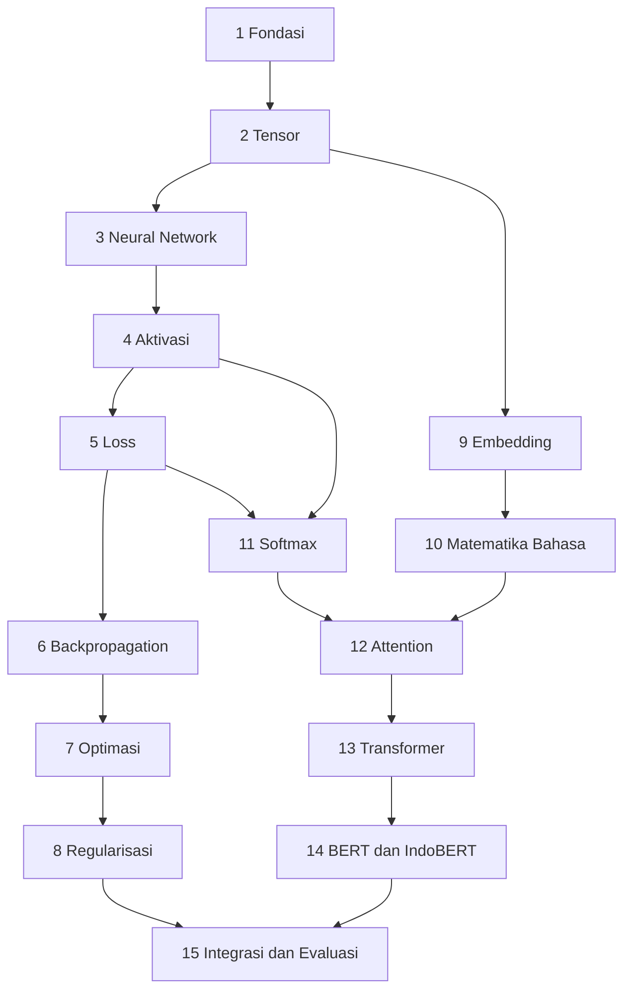

# Level 5 — Matematika Lanjutan untuk Deep Learning

Level ini memakai semua yang sudah dipelajari di Level 0–4 untuk memahami **matematika di balik Deep Learning**: tensor, neural network, fungsi aktivasi, loss, backpropagation, optimasi, regularisasi, embedding, softmax, attention, Transformer, hingga fondasi matematis BERT dan IndoBERT. Fokusnya pada pemahaman rumus, shape tensor, dan perhitungan manual yang bisa dilacak, bukan pada detail implementasi framework.

!!! success "Status materi"
    Level 5 **tersedia lengkap** (Part 1 sampai 15). Level 0 sampai 4 juga sudah tersedia lengkap. Peta belajar ini berakhir di Level 5.

## Prasyarat

Konsep penting dirangkum singkat saat dibutuhkan. Bagian berikut sebaiknya sudah dikuasai:

- [Level 2 Part 3 — Matriks](../level-2-aljabar-linear-dan-kalkulus/03-matriks.md) dan [Part 8 — Gradien](../level-2-aljabar-linear-dan-kalkulus/08-turunan-parsial-dan-gradien.md): perkalian matriks dan gradien.
- [Level 2 Part 9 — Chain Rule dan Backpropagation](../level-2-aljabar-linear-dan-kalkulus/09-chain-rule-dan-backpropagation.md) dan [Part 11 — Gradient Descent](../level-2-aljabar-linear-dan-kalkulus/11-optimasi-dan-gradient-descent.md).
- [Level 3 Part 7 — Variabel Acak dan Distribusi](../level-3-probabilitas-dan-statistika/07-variabel-acak-dan-distribusi.md): probabilitas dan distribusi.
- [Level 4 Part 4 — Regresi Logistik](../level-4-matematika-ml-klasik/04-regresi-logistik.md), [Part 12 — Regularisasi](../level-4-matematika-ml-klasik/12-regularisasi-dan-reduksi-dimensi.md), dan [Part 13 — Integrasi](../level-4-matematika-ml-klasik/13-integrasi-dan-studi-kasus.md) (bagian kesiapan Level 5).

## Daftar materi

| Part | Materi | Jenis | Status |
|---|---|---|---|
| 1 | [Fondasi Matematika Deep Learning](01-fondasi-matematika-deep-learning.md) | esensial | Tersedia |
| 2 | [Tensor dan Operasi Multidimensi](02-tensor-dan-operasi-multidimensi.md) | esensial | Tersedia |
| 3 | [Matematika Neural Network](03-matematika-neural-network.md) | esensial | Tersedia |
| 4 | [Fungsi Aktivasi](04-fungsi-aktivasi.md) | esensial | Tersedia |
| 5 | [Loss Function](05-loss-function.md) | esensial | Tersedia |
| 6 | [Backpropagation Mendalam](06-backpropagation-mendalam.md) | esensial | Tersedia |
| 7 | [Optimasi Deep Learning](07-optimasi-deep-learning.md) | esensial | Tersedia |
| 8 | [Regularisasi dan Generalisasi](08-regularisasi-dan-generalisasi.md) | esensial | Tersedia |
| 9 | [Embedding dan Representasi Vektor](09-embedding-dan-representasi-vektor.md) | esensial | Tersedia |
| 10 | [Matematika Pemrosesan Bahasa](10-matematika-pemrosesan-bahasa.md) | esensial | Tersedia |
| 11 | [Softmax dan Probabilitas Keluaran](11-softmax-dan-probabilitas-keluaran.md) | esensial | Tersedia |
| 12 | [Attention dan Self-Attention](12-attention-dan-self-attention.md) | esensial | Tersedia |
| 13 | [Transformer](13-transformer.md) | esensial | Tersedia |
| 14 | [Fondasi Matematis BERT dan IndoBERT](14-fondasi-matematis-bert-dan-indobert.md) | esensial (pengantar) | Tersedia |
| 15 | [Integrasi dan Evaluasi Level 5](15-integrasi-dan-evaluasi.md) | evaluasi | Tersedia |

**Esensial** berarti dibutuhkan untuk memahami part berikutnya. **Pengantar** berarti konsepnya diperkenalkan dengan intuisi dan contoh kecil.

!!! note "Batas cakupan dan cara penyajian"
    - **Kode.** Perhitungan utama dilakukan manual dan diverifikasi dengan Python pustaka standar. Blok NumPy bersifat **opsional**, diberi label bahwa ia membutuhkan paket yang tidak dipasang oleh proyek ini, dan keluarannya berasal dari Python sistem dengan versi yang disebutkan. PyTorch tidak dijalankan.
    - **Data NLP bersifat contoh atau simulasi**, bukan hasil eksperimen nyata, dan diberi label begitu.
    - **Pengantar, bukan implementasi.** Arsitektur produksi dan teori yang sangat lanjut hanya disebut atau ditautkan.

## Catatan notasi

Beberapa huruf dipakai ulang dengan arti berbeda di part berbeda; arti selalu didefinisikan di tempat pemakaiannya.

| Simbol | Arti dan tempat |
|---|---|
| $\alpha$ | kemiringan Leaky ReLU (Part 4); kekuatan penalti regularisasi (Part 8); bobot attention $\alpha_{ij}$ (Part 12) |
| $\lambda$ | kelengkungan $L''$ pada analisis konvergensi (Part 7); koefisien *weight decay* AdamW (Part 14) |
| $\eta$ | *learning rate* (semua part) |
| $\mathbf{s}$ | rata-rata bergerak kuadrat gradien (Part 7); $s_{ij}$ adalah skor attention (Part 12) |
| $X$, $W^{[l]}$, $\mathbf{b}^{[l]}$ | data dan parameter lapisan; $Z=XW+\mathbf{b}$ (Part 1 dan 3) |

Indeks pada rumus dimulai dari 1; pada kode dimulai dari 0.

## Hubungan antarpart

